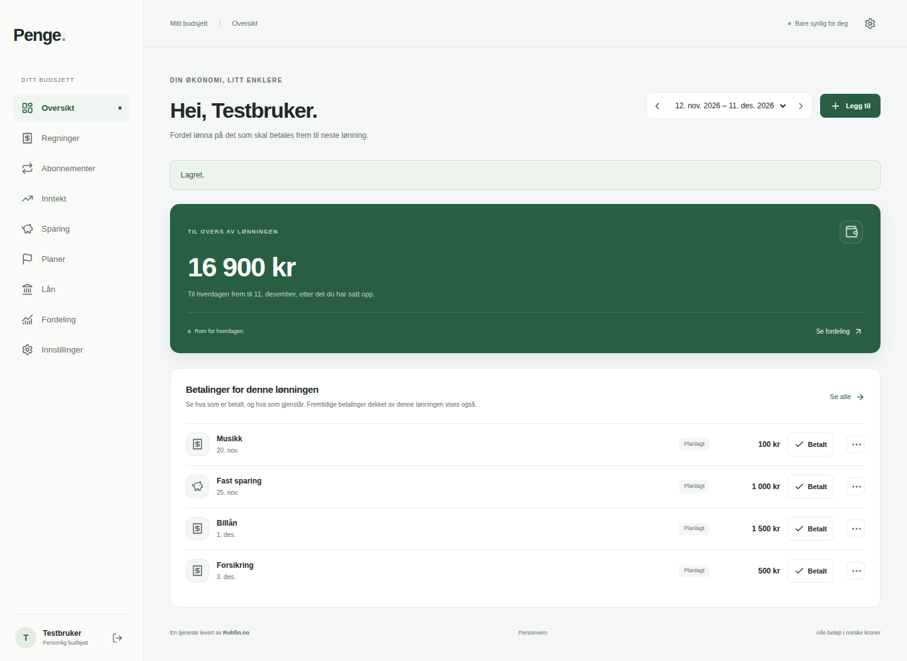
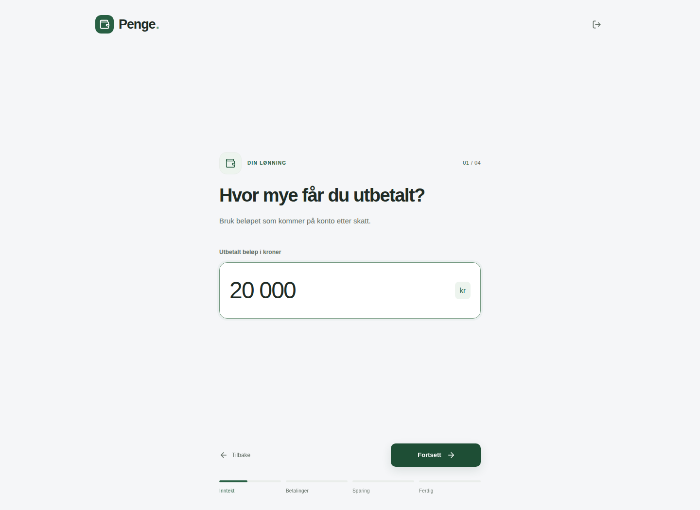

# Penge

Penge is a self-hosted budgeting app for deciding what each paycheck should cover: recurring bills, subscriptions, loan payments, savings and money left to spend. You enter the figures yourself, without recording every transaction.

The interface is currently Norwegian (Bokmål), with NOK amounts stored as integer øre. The source is publicly readable. License selection is pending; no redistribution license has been granted yet.

## Features

- Invite-only accounts, focused onboarding and private budgets.
- Independent paycheck periods with optional explicit carry-forward.
- Income, bills, subscriptions and minimum loan payments with dated amount changes.
- Individual payment status from the overview, including early payments funded by a chosen paycheck.
- Savings accounts/transfers/adjustments, purchase plans, JSON export/import and CSV mapping.
- Light/dark themes, responsive mobile navigation and Home Screen installation.
- Administrator invitations, account management and newsletter preferences.
- Branded transactional mail and Markdown newsletters with preview and unsubscribe.

There is no bank connection, automatic transaction ingestion, interest/amortization calculation, multi-currency accounting or full offline editing. Balances are user-maintained estimates.

## Screenshots

All visible account names and financial amounts are synthetic demo data.





## Technology and requirements

Next.js, React, TypeScript, Better Auth, Argon2id, PostgreSQL 17, Zod and Docker Compose. Node 24 runs inside containers. Use Linux, Docker Engine/Compose v2, Git, optional Python 3, roughly 2 GB free memory and adequate persistent disk.

## Quick installation

```sh
git clone https://github.com/08Robfin/penge.git
cd penge
python3 scripts/create-env.py
docker compose up -d --build
docker compose ps
```

Open **http://localhost:3000** on the server. The default listener is loopback only. For remote access, configure an HTTPS reverse proxy and generate configuration for its exact origin using `python3 scripts/create-env.py --url https://budget.example.org`.

The generator refuses to overwrite an existing .env. Alternatively copy .env.example, chmod 600 .env and replace both placeholders with independent cryptographically random values. Startup rejects placeholder secrets. Every installation gets a new project-scoped database volume; nothing connects to the original developer's installation.

## First account and administrator

```sh
docker compose run --rm tools run admin -- invite you@example.org
```

Open the printed private invitation, register with a unique password, then grant that account administrator access:

```sh
docker compose run --rm tools run admin -- grant-admin you@example.org
```

Refresh the app. Use Administrasjon for further invitations and account management. CLI invitation links are sensitive: share privately and avoid recorded terminals.

## Configuration and email

See [configuration](docs/CONFIGURATION.md), [self-hosting](docs/SELF-HOSTING.md) and [email](docs/EMAIL.md). Set RESEND_API_KEY or SMTP_URL plus a verified MAIL_FROM. Keep the mail worker running. Without delivery configuration, invitations can be copied manually, but password recovery/email verification and newsletter sending are unavailable.

Email uses encrypted queue payloads and bounded retries. Markdown preview supports headings, emphasis, lists and safe links. Newsletter membership currently defaults on; operators must review applicable consent requirements. Configurable operator credit does not replace a complete privacy notice.

## Updates and backups

Create an encrypted backup and verify your recovery key before upgrading. See [backup/restore](docs/BACKUPS.md) and [upgrades](docs/UPGRADING.md).

```sh
git pull --ff-only
docker compose build
docker compose run --rm tools run migrate
docker compose up -d
```

Migrations are tracked and applied automatically on initial startup. Never run docker compose down -v on data you want to keep. Keep off-server backups and recovery material.

## Security and development

Read [SECURITY.md](SECURITY.md), [audit findings](docs/SECURITY-AUDIT.md), [CONTRIBUTING.md](CONTRIBUTING.md) and [development/testing](docs/DEVELOPMENT.md). Server administrators can access the database; application administrators cannot browse other users' finances through the app.

CI validates source and security checks; it never deploys production. Use synthetic data only. Screenshots below use synthetic test accounts and invented amounts. Penge is a hobby project, not a bank or professional financial service.

## Troubleshooting

- Startup failure: verify independent secrets and exact origin; never paste .env into an issue.
- 403 after moving domains: update BETTER_AUTH_URL to the browser's origin and recreate app/worker.
- Pending email: check worker health and private provider settings. Avoid request/token logging.
- Missing data: confirm COMPOSE_PROJECT_NAME and the intended existing volume before any change.
- Old Home Screen icon: refresh or reinstall the shortcut.

## License

No license has been applied. Repository access alone grants no redistribution/publication rights. The owner will select a license before public release. Third-party dependencies retain their licenses.
